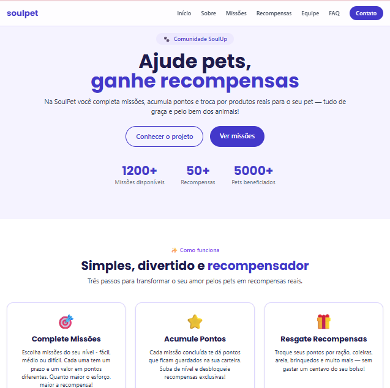
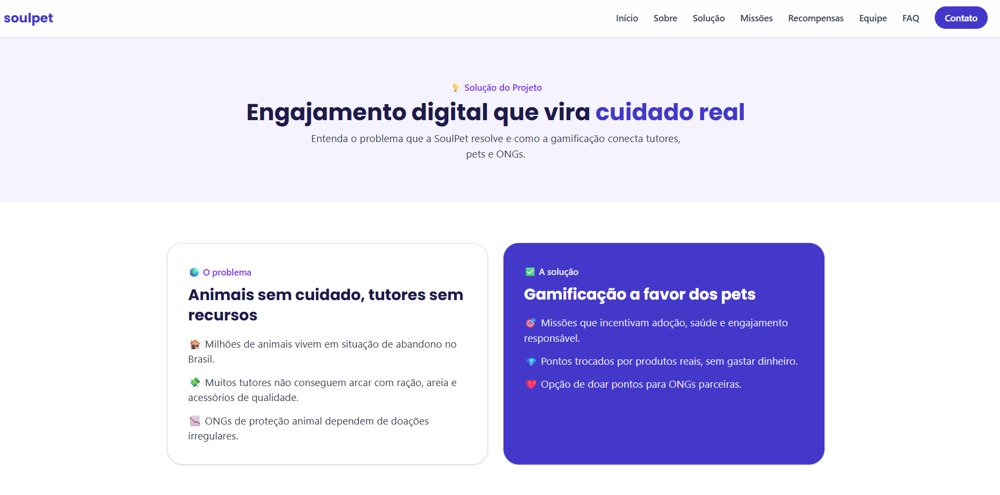
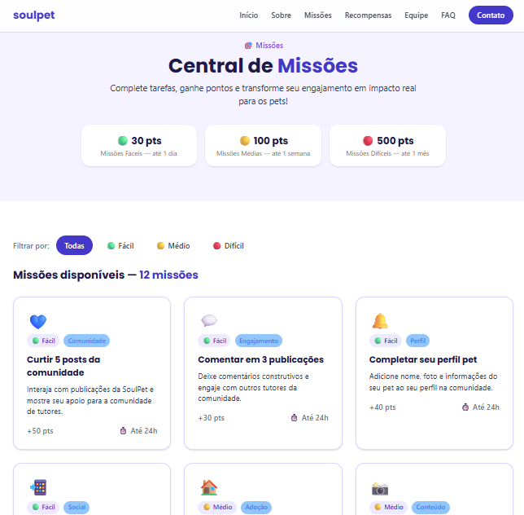
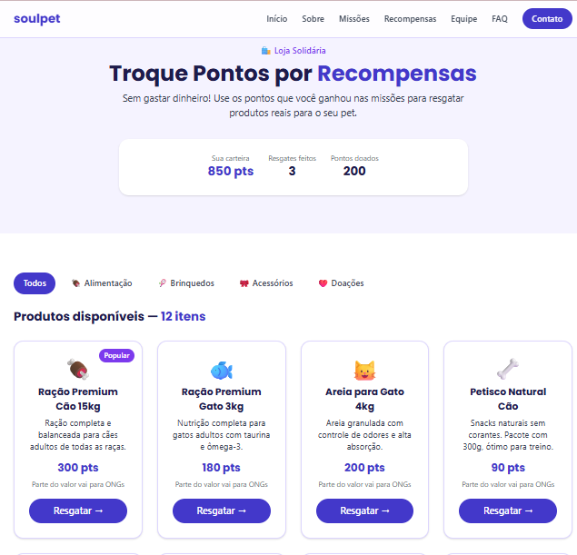

<div align="center">


### Gamificação para o bem-estar animal

Plataforma onde tutores de pets completam missões, acumulam pontos e trocam por recompensas reais ou doações a ONGs parceiras.


**[🌐 Acessar o site](https://soulpet-fiap.vercel.app) · [🎬 Assistir ao vídeo](https://youtu.be/fFBsJXBCKoc) · [☕ API Java](https://soulpet-api.onrender.com/missoes)**

</div>

---

## 📖 Sobre o projeto

O **SoulPet** é uma comunidade dentro da rede social **SoulUp**, focada no bem-estar animal. Nela, tutores de pets completam missões, acumulam pontos e trocam por produtos reais para seus animais — ou doam esses pontos para ONGs de proteção animal.

Este repositório contém o **Front-End da Sprint 04** do **Challenge FIAP — 2º Semestre 2026**, na disciplina de **Front-End Design Engineering**. Nesta etapa, a aplicação em **React + Vite + TypeScript** foi integrada à **API REST desenvolvida em Java** (disciplina de Domain Driven Design), consumindo dados reais do back-end, e publicada na **Vercel**.

## ✨ Funcionalidades

- 🎯 **Missões** com 3 níveis de dificuldade, filtráveis por categoria
- 🎁 **Loja de recompensas** com filtro por categoria e resgate de pontos
- 🔌 **Integração com a API Java** usando `fetch` nativo (GET, POST e DELETE)
- 💰 **Carteira de pontos** que soma as missões concluídas e desconta os resgates
- ⏳ **Tratamento de carregamento, erro e lista vazia** em todas as telas que usam a API
- 📄 **Rotas dinâmicas** para detalhe de missões e recompensas (`/missao/:id` e `/recompensa/:id`)
- 💡 **Página Solução**, apresentando o problema e a proposta do projeto
- 🚫 **Página 404** com redirecionamento automático para o início
- 🛡️ **Proteção contra erros** (Error Boundary e mensagens amigáveis quando a API falha)
- ❓ **FAQ em accordion** e ✉️ **formulário de contato** com validação
- 📱 **Totalmente responsivo** (mobile, tablet e desktop) com Tailwind CSS

## 🚀 Tecnologias utilizadas

| Tecnologia | Finalidade |
|---|---|
| ⚛️ **React** | Construção da interface e componentização |
| ⚡ **Vite** | Build tool e servidor de desenvolvimento |
| 🔷 **TypeScript** | Tipagem estática (interfaces, union types e intersection types) |
| 🎨 **Tailwind CSS** | Estilização utilitária e responsiva |
| 🧭 **React Router DOM** | Navegação SPA, rotas estáticas e dinâmicas |
| 📋 **React Hook Form** | Validação do formulário de contato |
| 🌐 **Fetch API** | Requisições HTTP para a API Java (sem bibliotecas externas) |
| ☕ **Java (API REST)** | Back-end que fornece e armazena os dados |
| ▲ **Vercel** | Hospedagem e deploy contínuo da aplicação |
| 🐙 **Git / GitHub / Gitflow** | Versionamento colaborativo (branches `main`, `develop` e `feature/*`) |

## 📁 Estrutura de pastas

```
sprint4-soulpet-front-end/
├── public/
│   ├── img/              # Logo e fotos das integrantes
│   └── screenshots/      # Capturas de tela usadas no README
├── src/
│   ├── components/       # Componentes reutilizáveis (Header, Footer, Cards, estados de loading/erro/vazio)
│   ├── data/             # Dados estáticos (FAQ, equipe)
│   ├── hooks/            # Hooks personalizados (useFetch)
│   ├── pages/            # Páginas da aplicação (Home, Solução, Missões, Recompensas, etc.)
│   ├── services/         # Camada de integração com a API (http.ts)
│   ├── types/            # Tipos TypeScript compartilhados
│   ├── App.tsx           # Configuração das rotas e do Error Boundary
│   ├── config.ts         # Usuário de demonstração (VITE_USUARIO_ID)
│   ├── main.tsx          # Ponto de entrada da aplicação
│   └── index.css         # Configuração do Tailwind e design tokens
├── .env.example          # Modelo da variável de ambiente VITE_API_URL
├── vercel.json           # Configuração de rotas SPA na Vercel
├── package.json
└── vite.config.ts
```

## 🔗 Como usar

### Links do projeto

| | Link |
|---|---|
| 🌐 **Aplicação na Vercel** | [soulpet-fiap.vercel.app](https://soulpet-fiap.vercel.app) |
| 🐙 **Repositório no GitHub** | [github.com/thaylira2026-hub/sprint4-soulpet-front-end](https://github.com/thaylira2026-hub/sprint4-soulpet-front-end) |
| 🎬 **Vídeo no YouTube** | [youtu.be/fFBsJXBCKoc](https://youtu.be/fFBsJXBCKoc) |
| ☕ **API Java publicada** | [soulpet-api.onrender.com](https://soulpet-api.onrender.com/missoes) |

### Executando localmente

**Pré-requisito:** [Node.js](https://nodejs.org/) 20 ou superior.

```bash
# 1. Clone o repositório
git clone https://github.com/thaylira2026-hub/sprint4-soulpet-front-end.git

# 2. Entre na pasta do projeto
cd sprint4-soulpet-front-end

# 3. Instale as dependências
npm install

# 4. Rode o projeto em ambiente de desenvolvimento
npm run dev
```

Acesse `http://localhost:5173` no navegador. 🎉

> 💡 O site já aponta para a API publicada no Render. Para usar outra URL, copie o `.env.example` para `.env` e altere a variável `VITE_API_URL`.

### Navegando pela aplicação

1. Na **Home**, conheça a proposta e veja missões e recompensas em destaque.
2. Em **Solução**, entenda o problema e como a SoulPet resolve.
3. Em **Missões**, filtre por dificuldade, abra uma missão e clique em **"Marcar como concluída"**.
4. Em **Recompensas**, resgate um produto com seus pontos ou cancele um resgate em "Meus resgates".
5. Em **Contato**, envie uma mensagem para a equipe.

## 🔌 Integração com a API

O front-end consome a **API REST em Java (Spring Boot + Oracle)** desenvolvida na disciplina de Domain Driven Design, publicada no Render:

**URL base:** `https://soulpet-api.onrender.com`

| Método | Endpoint | Uso no site | Página |
|---|---|---|---|
| `GET` | `/missoes` | Lista as missões | Home e Missões |
| `GET` | `/missoes/{codigo}` | Detalhe de uma missão | `/missao/:id` |
| `GET` | `/usuarios-missoes` | Missões concluídas pelo usuário | Missões e Recompensas |
| `POST` | `/usuarios-missoes` | Marca uma missão como concluída | `/missao/:id` |
| `DELETE` | `/usuarios-missoes/{codigo}` | Desfaz a conclusão | `/missao/:id` |
| `GET` | `/recompensas` | Lista os produtos da loja | Home e Recompensas |
| `GET` | `/recompensas/{codigo}` | Detalhe de uma recompensa | `/recompensa/:id` |
| `GET` | `/usuarios/{codigo}` | Dados e pontos do usuário | Recompensas |
| `GET` | `/usuarios-recompensas` | Histórico de resgates | Recompensas |
| `POST` | `/usuarios-recompensas` | Resgata uma recompensa | Recompensas e `/recompensa/:id` |
| `DELETE` | `/usuarios-recompensas/{codigo}` | Cancela um resgate | Recompensas |

**Organização no código:**
- `src/services/http.ts`: função central de requisições com `fetch` (sem Axios) e mensagens de erro amigáveis
- `src/services/missao-service.ts` e `src/services/recompensa-service.ts`: chamadas de cada recurso
- `src/hooks/use-fetch.ts`: hook que controla os estados de **carregando**, **sucesso** e **erro**
- `src/types/`: tipos TypeScript que espelham o JSON da API (interfaces, union e intersection types)

> 👤 **Usuário de demonstração:** o projeto não tem tela de login, então o site usa o usuário de código `1` do banco (configurável pela variável `VITE_USUARIO_ID`).
>
> ⏳ **Primeiro acesso:** a API está no plano gratuito do Render, que "dorme" sem uso. A primeira requisição pode levar até 1 minuto, e o site mostra um aviso enquanto isso.

## 👥 Autores e créditos

| Foto | Nome | RM | Turma | GitHub | LinkedIn |
|---|---|---|---|---|---|
|  | Bianca Pereira da Silva | 571077 | 1TDSR-2026 | [@biancapereirasilva](https://github.com/biancapereirasilva) | [LinkedIn](https://www.linkedin.com/in/bianca-pereira-866845213/) |
|  | Isabelle Souza Lima Pires Araujo | 569370 | 1TDSR-2026 | [@isasouzz](https://github.com/isasouzz) | [LinkedIn](https://www.linkedin.com/in/isabelle-souza-9342a027a/) |
|  | Maria Eduarda Cavallari Quarelo | 570462 | 1TDSR-2026 | [@dudaquarelo](https://github.com/dudaquarelo) | [LinkedIn](https://www.linkedin.com/in/dudaquarelo) |
|  | Thays Lira de Oliveira | 568799 | 1TDSR-2026 | [@thaylira2026-hub](https://github.com/thaylira2026-hub) | [LinkedIn](https://www.linkedin.com/in/thays-lira-538619186/) |

🎓 **FIAP** — Análise e Desenvolvimento de Sistemas · Challenge 2026 · Sprint 04

## 📸 Capturas de tela

<div align="center">

### 🏠 Home


### 💡 Solução


### 🎯 Missões


### 🎁 Recompensas


### ✉️ Contato


</div>

## 📩 Contato

Dúvidas ou sugestões sobre o projeto?

- 📧 **E-mail:** soulpet@fiap.com.br
- 🌐 **Formulário:** [soulpet-fiap.vercel.app/contato](https://soulpet-fiap.vercel.app/contato)
- 🐙 **Issues:** [abra uma issue no GitHub](https://github.com/thaylira2026-hub/sprint4-soulpet-front-end/issues)

---

<div align="center">

Feito com 💜 pela equipe SoulPet

</div>